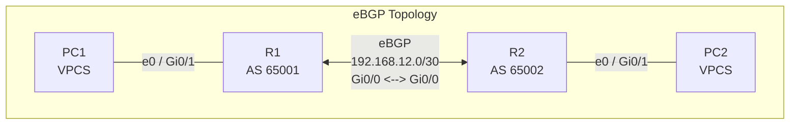

# Lab 01 — eBGP Basics

## 1. Objectives

By completing this lab, you should be able to:

- Explain the purpose of an eBGP session.
- Identify the autonomous system number of each router.
- Configure IP connectivity between two directly connected routers.
- Establish and verify an eBGP neighbor relationship.
- Advertise a test network using BGP.
- Verify BGP routes and end-to-end connectivity.

## 2. Lab Environment

| Component | Planned value |
|-----------|---------------|
| Emulator | GNS3 |
| Router R1 | Cisco image to be confirmed |
| Router R2 | Cisco image to be confirmed |
| Routing protocol | eBGP |
| Number of autonomous systems | 2 |

The router models, interface names and supported commands will be
confirmed before configuration begins.

## 3. Topology

The following Mermaid diagram represents the planned logical topology.
It is not yet a verified GNS3 project.

## 4. Planned Addressing

| Device | Interface or network | Planned address |
|--------|----------------------|-----------------|
| R1 | Inter-router link | 192.168.12.1/30 |
| R2 | Inter-router link | 192.168.12.2/30 |
| R1 | Test LAN | 192.168.1.0/24 |
| R2 | Test LAN | 192.168.2.0/24 |

All addresses are provisional. The interface assignments and LAN
implementation will be confirmed during the GNS3 build.

## 5. Implementation Plan

1. Confirm available Cisco router images in GNS3.
2. Add R1 and R2 and connect their interfaces.
3. Configure the inter-router IP addresses.
4. Verify basic IP connectivity.
5. Configure the eBGP neighbor relationship.
6. Verify the BGP session.
7. Advertise a test prefix from each router.
8. Verify learned routes and test connectivity where applicable.

## 6. Verification Checklist

- [ ] Router interfaces are operational.
- [ ] The directly connected routers can ping each other.
- [ ] The eBGP neighbor reaches the Established state.
- [ ] BGP prefixes are advertised and received as intended.
- [ ] The routing table contains the expected BGP routes.
- [ ] Connectivity tests succeed where the topology supports them.

Useful commands will be confirmed against the selected Cisco image.
Expected output and actual observed output will be documented separately.

## 7. Troubleshooting

Potential checks include:

- Interface status and IP addressing
- Reachability of the neighbor address
- Correct local and remote AS numbers
- Neighbor configuration and BGP session state
- Prefix advertisement and routing-table entries

Specific faults and their solutions will be recorded as they are
encountered during the lab.

## 8. Evidence and Configurations

- `configs/`: validated router configurations
- `screenshots/`: relevant GNS3 and CLI screenshots

Files and screenshots will be added after the corresponding steps
have been performed and verified.

## 9. Lab Status

**Status:** Documentation prepared; GNS3 implementation pending.
